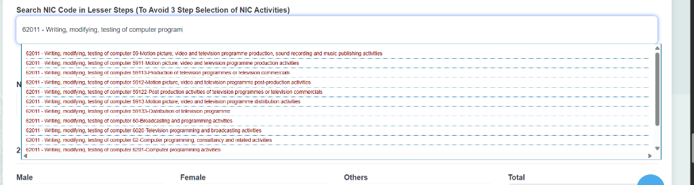
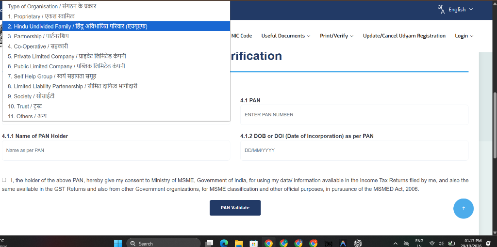
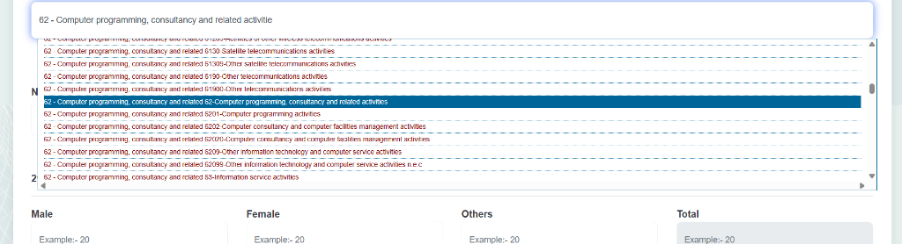
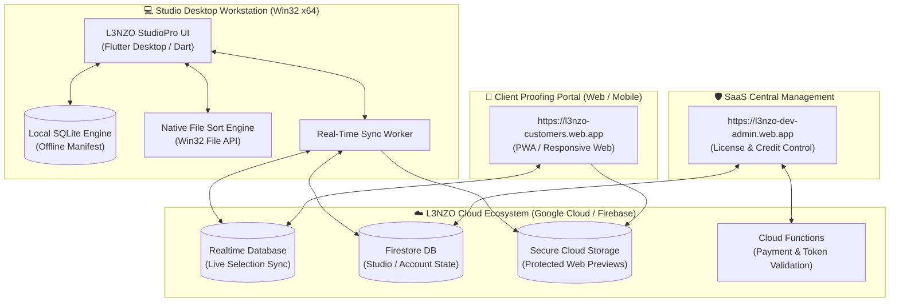

  

    

  

  

    <strong>The ultimate high-performance Windows desktop platform for wedding studios, event photographers, and creative agencies.</strong>
  

  

    
    
  

  

    
    
    
    
    
  

---

## ⚡ The Problem L3NZO Solves

Traditional wedding and commercial photography workflows are slow, fragmented, and painful:
- ❌ Sharing Google Drive links or USB pen drives causes endless confusion.
- ❌ Clients take weeks to WhatsApp filenames back (`IMG_4021.jpg`, `IMG_4022.jpg`).
- ❌ Photographers spend hours manually finding, copying, and sorting selected photos.
- ❌ Uncompressed images eat up huge cloud storage bills.

**L3NZO StudioPro transforms this entire cycle into an automated, zero-stress pipeline:**
1. **Instant Upload & Smart Compression**: Studio drags 2,000+ photos into L3NZO. Fast thumbnail generation and multi-threaded background sync.
2. **Instant Client Proofing Portal**: Client opens a secured private web link on their mobile phone or laptop. Smooth swipe gestures, favorite toggling, and comment annotations.
3. **Real-Time Live Sync**: When a client taps "Favorite" on their phone, the desktop app updates in real-time within **50 milliseconds** via Firebase Realtime Database.
4. **1-Click Auto Sorting**: Hit **"Organize Album"** in L3NZO Desktop — the software automatically creates `Selected/`, `Rejected/`, and `Print-Ready/` folders locally on the photographer's hard drive!

---

## 🖥️ Screen Previews

  <table>
    <tr>
      <td width="50%" align="center">
        <strong>📂 Album Management & Instant Status</strong>  
        
      </td>
      <td width="50%" align="center">
        <strong>⚡ High-Speed Batch Uploader & Sync</strong>  
        
      </td>
    </tr>
    <tr>
      <td colspan="2" align="center">
        <strong>📊 Studio Operations & Real-Time Analytics</strong>  
        
      </td>
    </tr>
  </table>

---

## 🚀 Key Architectural Features

### ⚡ Millisecond Two-Way Sync
Powered by **Firebase Realtime Database (RTDB)** with local fallback. Studio managers see client selections live as they happen in client homes.

### 🛡️ Screenshot & Piracy Protection
Client web portal features dynamic, high-fidelity watermarking and right-click protection, ensuring client proofs cannot be pirated or screenshotted before final payment.

### 🔒 Zero-Leak Local Storage Engine
Uses an encrypted, transactional **SQLite** local database (`sqflite_common_ffi`). Albums, metadata, and selection caches stay securely on your local workstation even without an internet connection.

### 📂 Zero-Copy Intelligent Folder Sorting
Say goodbye to manual searches. L3NZO scans the client's selection manifest and automatically copies/moves high-resolution RAW or JPEG files to designated print folders in seconds.

### 💰 90% Cloud Cost Reduction
Integrated Cloud Storage Lifecycle rules automatically transition client previews to archival tiers or auto-expire them post-selection, keeping operational costs close to zero.

---

## 🏗️ System Architecture

---

## 💻 System Requirements

| Specification | Minimum | Recommended |
| :--- | :--- | :--- |
| **Operating System** | Windows 10 (Build 1809 or higher, 64-bit) | Windows 11 (64-bit) |
| **Processor** | Intel Core i3 / AMD Ryzen 3 (Dual-core 2.4 GHz) | Intel Core i5/i7 or AMD Ryzen 5/7 (Quad-core+) |
| **RAM** | 4 GB | 8 GB – 16 GB (for handling 5,000+ photo shoots) |
| **Storage** | 300 MB free space for software | SSD storage for optimal photo indexing |
| **Display** | 1280 x 720 resolution | 1920 x 1080 (Full HD) or higher |
| **Network** | Broadband internet connection for sync | 50 Mbps+ recommended for rapid batch uploads |

---

## 📥 Installation & Setup Guide

### 1. Download Installer
Grab the official Windows installer `.exe` from our GitHub Releases page:
👉 **[Download Latest L3NZO StudioPro Installer](https://github.com/vasanth5545/l3nzo/releases/latest)**

### 2. Run Setup
1. Double-click `L3NZO_StudioPro_Setup.exe`.
2. Follow the setup wizard to install L3NZO to your local machine (Default: `C:\Program Files\L3NZO StudioPro`).
3. Allow the installer to create a desktop shortcut.

### 3. Login & Connect
1. Launch **L3NZO StudioPro** from your desktop.
2. Sign in with your registered studio email or Google account.
3. Start creating albums, upload client shoots, and share real-time selection links immediately!

---

## 🛡️ Enterprise Registration & Legal Compliance

**L3NZO StudioPro** is a proprietary software suite engineered and operated by:

- **Enterprise Name:** L3NZO. SOFTWARE SERVICES
- **Govt. of India MSME Registration:** `UDYAM-TN-25-0064013`
- **National Industry Classification (NIC):** 62011 (Writing, modifying, testing of computer software)
- **District:** Thiruvarur, Tamil Nadu, India
- **Official Portals:**
  - Main Website: [l3nzo.web.app](https://l3nzo.web.app)
  - Customer Proofing: [l3nzo-customers.web.app](https://l3nzo-customers.web.app)
  - Admin Portal: [l3nzo-dev-admin.web.app](https://l3nzo-dev-admin.web.app)

*Copyright © 2026 L3NZO. SOFTWARE SERVICES. All Rights Reserved. Proprietary and Confidential.*

---

## 💬 Support & Bug Reports

Found a bug or have a feature request for future releases?
- Report an issue via [GitHub Issues](https://github.com/vasanth5545/l3nzo/issues).
- Email founder support: `vasanthvarman07@gmail.com`.
